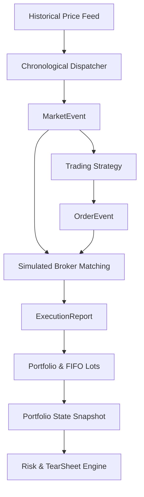

# QuantPulse

> **Institutional-Grade Event-Driven Algorithmic Trading Backtesting & Quantitative Risk Engine**

[](https://github.com/jashp144/quantpulse/actions/workflows/ci.yml)
[](https://www.python.org/)
[](LICENSE)
[](https://github.com/astral-sh/ruff)
[](https://github.com/jashp144/quantpulse)
[](CONTRIBUTING.md)

---

## 📌 Table of Contents
- [Overview](#-overview)
- [Key Features](#-key-features)
- [Architecture](#-architecture)
- [Installation](#-installation)
- [Quickstart Guide](#-quickstart-guide)
- [Quantitative Mathematical Formulas](#-quantitative-mathematical-formulas)
- [Performance Tear-Sheet Example](#-performance-tear-sheet-example)
- [API Reference](#-api-reference)
- [Testing & Verification](#-testing--verification)
- [License & Author](#-license--author)

---

## 🌟 Overview
`quantpulse` is an institutional-grade, event-driven backtesting and quantitative risk analytics framework designed to eliminate lookahead bias, simulate realistic exchange mechanics, and compute rigorous statistical risk profiles.

Unlike naive vectorized backtesting libraries that assume instantaneous fills at mid-market prices, `quantpulse` models discrete order books, limit/stop matching, maker-taker fee structures, and Almgren-Chriss square-root volume participation market impact.

---

## 🚀 Key Features

- **Event-Driven Architecture**: Chronological event loop processing discrete `MarketEvent`, `SignalEvent`, `OrderEvent`, and `FillEvent` payloads with zero lookahead bias.
- **Realistic Exchange Matching**:
  - Full order type support: `Market`, `Limit`, `StopLoss`, `StopLimit`.
  - Slippage modeling: Fixed basis-point slippage and **Almgren-Chriss market impact** with square-root volume participation.
  - Commission modeling: Maker/Taker exchange fee schedules, flat per-share fees, and volume-tiered fee models.
- **Multi-Asset Portfolio Accounting**:
  - Exact **FIFO tax lot matching** for realized PnL on multi-lot entries and exits.
  - Reg-T Initial & Maintenance margin tracking, leverage monitoring, and automatic margin call detection.
  - Continuous mark-to-market valuation across concurrent asset positions.
- **Institutional Risk & Performance Analytics**:
  - Annualized Sharpe Ratio, Sortino Ratio (downside semideviation), and Calmar Ratio.
  - High-Water Mark (HWM), Maximum Drawdown (MDD), and Maximum Drawdown Duration tracking.
  - Parametric and Historical **Value-at-Risk (VaR 95%, 99%)** and **Conditional VaR / Expected Shortfall (CVaR)**.
  - Jensen's Alpha, Beta, and Information Ratio relative to market benchmarks.
- **Production Trading Strategies**: Built-in `MovingAverageCrossoverStrategy`, `MeanReversionStrategy` (Bollinger Bands + RSI), and `VolatilityBreakoutStrategy` (Donchian Channels + ATR trailing stop).
- **Automated Tear-Sheets**: Formatted Markdown and ASCII performance tear-sheets ready for executive reports and investment committees.

---

## 🏗️ Architecture

```
+-------------------------------------------------------------------------+
|                           BacktestEngine Loop                           |
|                                                                         |
|  [Historical Bars / Ticks] ---> Chronological Event Queue               |
|                                         |                               |
|                                         v                               |
|  [Simulated Broker] <---------- [MarketEvent] ---------> [Strategy]     |
|         |                                                    |          |
|   (Fill Matching,                                      (Signal Logic)   |
|   Slippage, Fees)                                            |          |
|         |                                                    v          |
|         +----------------> [ExecutionReport] <------- [OrderEvent]      |
|                                  |                                      |
|                                  v                                      |
|                       [Portfolio Accounting]                            |
|                     (FIFO Lots, Cash, Margin)                           |
|                                  |                                      |
|                                  v                                      |
|                       [Performance & Risk Engine]                       |
|                   (Sharpe, Sortino, VaR/CVaR, Tear-Sheet)               |
+-------------------------------------------------------------------------+
```



---

## 📦 Installation

### From Source
```bash
git clone https://github.com/jashp144/quantpulse.git
cd quantpulse
pip install -e .
```

### With Development Tooling
```bash
pip install -e ".[dev]"
```

---

## ⚡ Quickstart Guide

```python
import pandas as pd
from quantpulse import (
    BacktestEngine,
    MovingAverageCrossoverStrategy,
    FlatFeeModel,
    FixedBasisPointSlippage,
)

# 1. Load historical price data
df = pd.read_csv("AAPL.csv", parse_dates=["timestamp"], index_col="timestamp")

# 2. Configure engine with institutional parameters
engine = BacktestEngine(
    initial_cash=100_000.0,
    fee_model=FlatFeeModel(per_share=0.005, min_fee=1.0),
    slippage_model=FixedBasisPointSlippage(basis_points=5.0), # 5 bps slippage
)

# 3. Attach strategy and data
strategy = MovingAverageCrossoverStrategy(fast_period=10, slow_period=30, trade_size=100.0)
engine.set_strategy(strategy)
engine.add_data("AAPL", df)

# 4. Execute backtest
results = engine.run()

# 5. Output formatted performance tear-sheet
print(results.tear_sheet("ascii"))
```

---

## 📐 Quantitative Mathematical Formulas

### 1. Almgren-Chriss Market Impact Slippage
$$\Delta P = \operatorname{sign}(Q) \cdot P_{\text{mid}} \cdot \left( \eta \cdot \left(\frac{|Q|}{\max(V_{\text{bar}}, |Q|)}\right)^\alpha + \frac{\text{half\_spread}}{P_{\text{mid}}} \right)$$
Where $\eta$ is liquidity impact parameter, $\alpha = 0.5$ (square-root law), $Q$ is order quantity, and $V_{\text{bar}}$ is bar volume.

### 2. Risk-Adjusted Return Ratios
- **Sharpe Ratio**:
  $$\text{Sharpe} = \frac{\operatorname{mean}(R_t - r_f)}{\operatorname{std}(R_t)} \times \sqrt{252}$$
- **Sortino Ratio** (Downside Semideviation):
  $$\text{Sortino} = \frac{\operatorname{mean}(R_t - r_f)}{\sqrt{\frac{1}{N} \sum_{t=1}^N \min(0, R_t - T)^2}} \times \sqrt{252}$$
- **Calmar Ratio**:
  $$\text{Calmar} = \frac{CAGR}{|MDD|}$$

### 3. Value-at-Risk (VaR) & Expected Shortfall (CVaR)
- **Parametric VaR (95%)**:
  $$\text{VaR}_{0.95} = - (\mu - z_{0.95} \cdot \sigma)$$
- **Conditional VaR (Expected Shortfall)**:
  $$\text{CVaR}_\alpha = - \left(\mu - \sigma \cdot \frac{\phi(z_\alpha)}{1 - \alpha}\right)$$

---

## 📊 Performance Tear-Sheet Example

```text
=================================================================
              QUANTPULSE PERFORMANCE TEAR-SHEET
=================================================================
 Initial Capital:       $    100,000.00
 Final Equity:          $    142,850.20
 Total Return:                    42.85%
 CAGR:                            42.85%
 Annualized Volatility:           16.42%
-----------------------------------------------------------------
 Sharpe Ratio:                   2.6094
 Sortino Ratio:                  3.8120
 Calmar Ratio:                   5.4377
 Maximum Drawdown:                -7.88%
 Max Drawdown Duration:              14 bars
-----------------------------------------------------------------
 Parametric VaR (95%):             1.52%
 Conditional VaR (95%):            1.98%
 Total Trades:                       38
 Win Rate:                        68.42%
 Profit Factor:                  2.7410
=================================================================
```

---

## 📚 API Reference

### `BacktestEngine`
- `__init__(initial_capital=100000.0, initial_cash=None, fee_model=None, slippage_model=None, risk_free_rate=0.0, benchmark_returns=None)`
- `add_data(symbol: str, data: pd.DataFrame | list[Bar]) -> None`
- `set_strategy(strategy: BaseStrategy) -> None`
- `run(data=None, price_data=None, strategy=None) -> BacktestResult`

### `Portfolio`
- `mark_to_market(prices: dict[str, float], timestamp: datetime) -> PortfolioState`
- `process_fill(report: ExecutionReport) -> None`
- `can_afford_order(order: Order, current_price: float) -> bool`
- `is_margin_call() -> bool`

### `RiskMetrics`
- `sharpe_ratio(returns, risk_free_rate=0.0, periods_per_year=252) -> float`
- `sortino_ratio(returns, target_return=0.0, risk_free_rate=0.0, periods_per_year=252) -> float`
- `max_drawdown(equity) -> float`
- `max_drawdown_duration(equity) -> int`
- `calmar_ratio(equity, periods_per_year=252) -> float`
- `beta(portfolio_returns, benchmark_returns) -> float`
- `alpha(portfolio_returns, benchmark_returns, risk_free_rate=0.0) -> float`

---

## 🧪 Testing & Verification

Run the full automated test suite with coverage report:
```bash
# Run pytest with strict coverage assertion (>=85%)
pytest -v --cov=quantpulse --cov-report=term-missing

# Run code style & formatting checks
ruff check .
ruff format --check .
```

---

## 📄 License & Author

This project is licensed under the [MIT License](LICENSE).  
Authored and maintained by **Jash Patel** ([@jashp144](https://github.com/jashp144) / `jashp144@gmail.com`).
